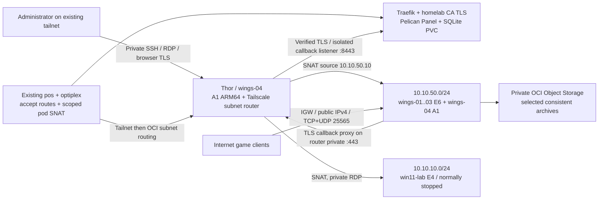

# Target architecture

| Node | Shape | CPU / RAM | Boot / data | Architecture |
|---|---|---|---|---|
| wings-01..03 each | VM.Standard.E6.Flex | 2 / 16 GB | 50 / 200 GB | x86-64 Ubuntu 26.04 |
| wings-04 (existing Thor) | VM.Standard.A1.Flex | existing 4 / 24 GB | existing 100 / none separate | ARM64 Ubuntu 26.04 Minimal |
| win11-lab | VM.Standard.E4.Flex | 2 / 16 GB | 100 / none | Windows 11 x86-64; blocked pending supported image+TPM path |

Paid storage is exactly 850 GB; Thor's 100 GB is separate. All disks stay at the selected 10 VPU balanced tier. Prevent-destroy protects compute/volumes/network; ignored imported launch fields preserve actual settings. This preservation phase intentionally avoids changing Thor's OCI/guest hostname; use `wings-04` in Panel and inventory.

## Routing and sources

Advertise only `10.10.50.0/24` and `10.10.10.0/24`. Use default subnet-router SNAT: destination instances see router private source `10.10.50.10`, so SSH/API/SFTP/exporter/RDP ingress is scoped to that /32. No VCN return routes to 100.64/10 or homelab are needed for these forwarded connections. Disable neither SNAT nor VNIC source/destination checking casually; a no-SNAT design would need explicit return routes, VNIC forwarding settings and different security sources.

The router's own private address is reached over its Tailscale interface before SNAT. Its host firewall therefore allows explicit administrator tailnet sources plus the Kubernetes nodes for Wings API/metrics; do not expect a rule allowing only its private /32 to permit its own tailnet-delivered management traffic.

`homelab-routes.yaml` explicitly enables route acceptance on both Kubernetes hosts and persists pod-source SNAT for **only OCI destination subnets**, so pod egress has a tailnet identity that can receive a grant. Test from a pod scheduled on each host; node-level ping is insufficient. The actual `ansible/tailscale/policy.hujson` must replace allow-all network rules and pass its embedded Tailscale tests; no OAuth/auth keys go to Terraform or Git.

Wings on non-router nodes needs callbacks to Panel but has no Tailscale client. A private TLS Caddy proxy on the existing router forwards `pelican.home.internal` to `100.114.113.82:8443`, with the Panel Host header, SNI and trusted homelab CA. OCI guests resolve that name to the router private IP; homelab resolves it to Traefik. This avoids reliance on the offline home subnet advertiser or public Panel exposure. The homelab listener routes only the Panel hostname and `/api/remote/…`; other sites/UI/admin APIs do not appear there. Persistent pre-DNAT filtering admits only Thor over Tailscale, and the final grant denies Thor shared pos:443. See [callback isolation](callback-security.md) for deployment evidence and staging/recovery. The callback proxy is single-host dependent on Thor/pos; recovery instructions cover that limitation.

## TLS, browsers and game ports

Panel: `https://pelican.home.internal`, ingress TLS from existing `homelab-ca`. Wings: `wings-01.oci.home.internal` through `wings-04.oci.home.internal`, HTTPS 8080 with per-node SAN certificates from the same CA. Browsers use those private FQDNs for websocket console/file features, so administrators need approved routes, DNS and CA trust too. Panel's image gets a combined CA bundle, with a ConfigMap generated directly from `pki/homelab-root-ca.crt` through the shared `pki/` Kustomize base. There is one CA certificate source; no copied certificate to maintain.

API, SSH, SFTP (2022) and node-exporter (9100) are private. No public Wings API is needed in this topology. Only TCP/UDP 25565 is allocated publicly initially, independently on every node. Configure allocations using each node's actual private bind IP; OCI public IPv4 NAT forwards to it. Additional games need explicit matching Panel allocations, Terraform TCP/UDP rules and Ansible firewall ports. Docker forwarding is filtered in DOCKER-USER; UFW alone would not cover published game ports. IPv6 administration is blocked by host rules and no public IPv6 ingress is provisioned.

## Panel release and persistence

Official image `ghcr.io/pelican/panel:v1.0.0-rc.2` is pinned to manifest digest `sha256:cb717c15da9bcdc93f22a22a02d5460a1ce51fd03f2975b4ce53d745f4cc9ac8`. Its tagged Dockerfile/entrypoint/supervisor configuration was inspected. It runs Caddy, PHP-FPM, a database queue worker and supercronic scheduler in **one supported image**, so additional duplicate workers/cron deployments are inappropriate here. Use SQLite, file cache/sessions and database queue, all supported by the official Docker setup. `/pelican-data` includes `.env`, database and application storage; logs share the 10 GiB local-path PVC. Recreate strategy and one replica avoid concurrent migrations/SQLite writes. `APP_KEY` is SOPS-encrypted. Installer and admin account creation are still required. This release is a release candidate; upgrades need backup and review.

Local-path is not high-availability replicated storage: it pins storage to a homelab host and waits for that host after failure. Prune/Delete annotations guard the claim; actual PV reclaim policy must be patched to Retain during approved deployment and restore tested. Restore an off-node backup to recover permanent node loss.

Thor uses the ARM64 Wings binary with a release checksum; paid nodes use amd64. Select a game image whose manifest includes linux/arm64 and verify the egg/binary supports it. x86-64 images and native game binaries do **not** run natively on Thor. Do not use emulation as acceptance evidence. The declarative Mindustry v160.7 acceptance egg pins its server JAR checksum, multiarch Java runtime and installer digests. The four deployed games use native amd64 on paid nodes and native arm64 on Thor. Public TCP and application-level UDP discovery checks passed on every node, including after reboot; an interactive player session is not claimed.

Sources: [Pelican Wings](https://pelican.dev/docs/wings/install/), [official Docker deployment](https://pelican.dev/docs/panel/advanced/docker/), [tagged container supervisor](https://github.com/pelican-dev/panel/blob/v1.0.0-rc.2/docker/supervisord.conf), [Docker Ubuntu support/firewall constraints](https://docs.docker.com/engine/install/ubuntu/), [Tailscale subnet routing](https://tailscale.com/docs/features/subnet-routers).
